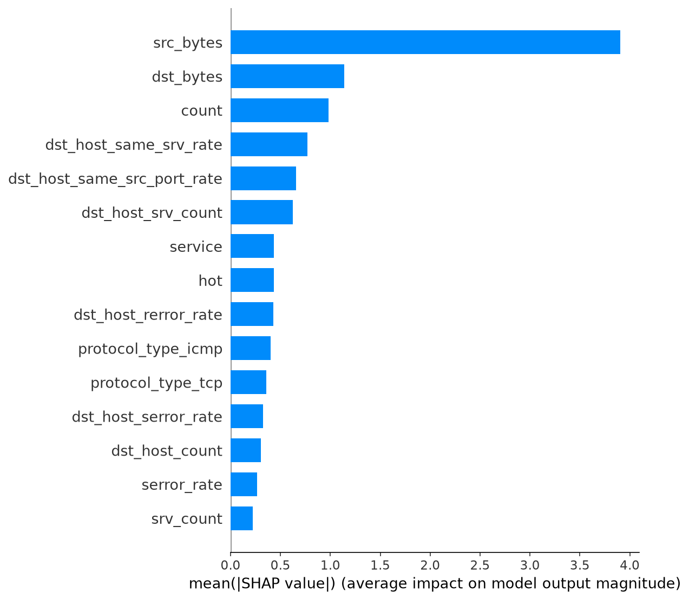
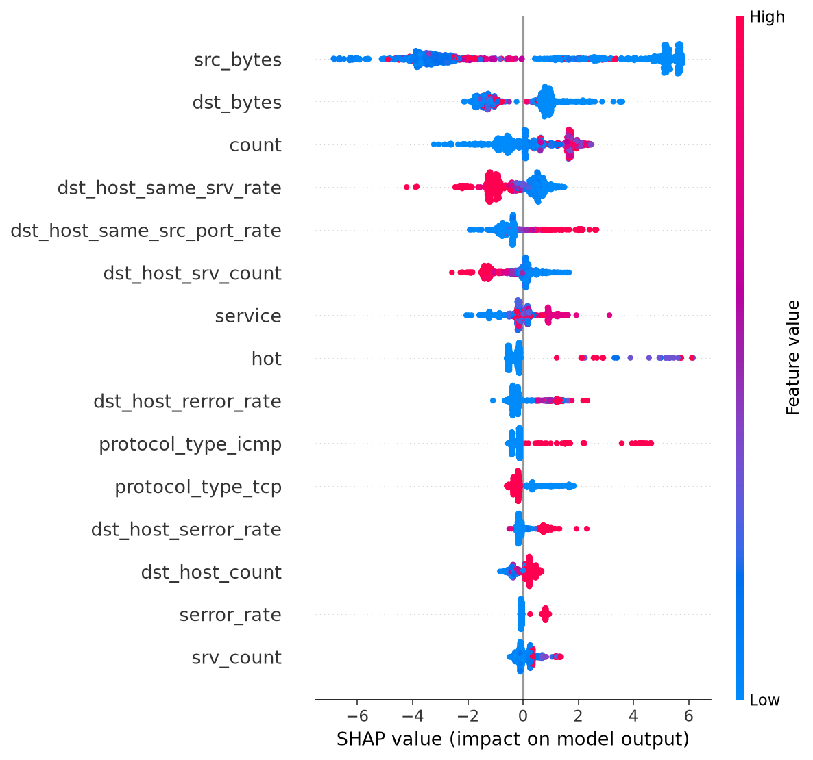
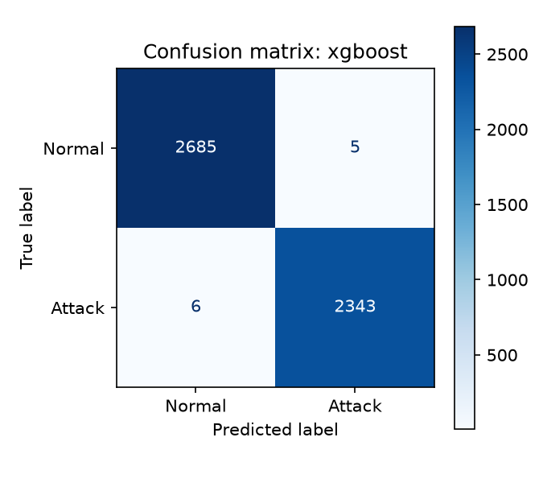

# Intrusion: an alarm that explains itself

A network intrusion detector that does not just say "attack". It also tells you **why**.

---

## The story in one minute

Imagine a smoke alarm that screams "FIRE, 98% sure!" but never tells you which room is burning.
You would have to run through the whole house to check. If it did this ten times a day, you would soon stop trusting it.

Computer networks have the same problem. Security teams use smart programs that watch network traffic and raise an alarm when something looks like an attack. These programs are very accurate, but most of them are **black boxes**: they give a verdict and a confidence score, and nothing else. The analyst has to dig through raw traffic by hand to find out whether the alarm is real. Too many unexplained alarms lead to **alert fatigue**, where people start ignoring them.

**This project builds the smoke alarm that points to the room.** For every network connection it checks, it says:

1. whether the traffic looks normal or like an attack,
2. how sure it is, and
3. **which facts about the connection led to that decision**, written in plain English.

Here is a real alert from this project:

> **ATTACK DETECTED (100.0% confidence).** Pattern hint: SYN-flood-like traffic (DoS family).
> Main reasons: bytes sent by the source = 0; connections to the same host in the last 2 s = 122; SYN error rate (same host) = 100%.

An analyst can read that in five seconds and agree or disagree with it.

---

## What the project does

- Learns to tell normal traffic from attacks, using a well-known practice dataset called **NSL-KDD**.
- Explains each decision with **SHAP**, a method that measures how much each fact pushed the decision toward "attack" or "normal".
- Also tries a second method, **LIME**, so the two explanations can be compared.
- Turns the numbers into **plain-English alerts**.
- Shows everything on a **web dashboard** where you upload a file of connections and read the results.

---

## How it works, step by step

```
 NSL-KDD data  -->  Clean and prepare  -->  Train the models  -->  Check how good they are
                                                                        |
                                                                        v
  Analyst reads  <--  Web dashboard  <--  Plain-English alerts  <--  SHAP explains each decision
   the alerts
```

1. **Get the data.** We use the 20% training file of NSL-KDD: 25,192 network connections, each described by 41 facts (how long it lasted, how many bytes were sent, how many errors happened, and so on). Each one is labelled normal or a type of attack.
2. **Prepare it.** Words such as `tcp` or `http` are turned into numbers, large numbers are scaled so they are comparable, and the data is split: 80% to learn from, 20% kept hidden for the final exam.
3. **Train.** Four models learn from the 80%: Decision Tree, Logistic Regression, Random Forest and XGBoost.
4. **Test.** The models take the hidden 20% exam, and we measure how many they get right and how many false alarms they raise.
5. **Explain.** For the best model (XGBoost), SHAP works out which facts mattered most, both overall and for each single connection.
6. **Write the alert.** A small set of rules turns those results into a short sentence an analyst can read.
7. **Show it.** A Flask web dashboard lets you upload a CSV, then see counts, charts, alerts and explanation plots.

---

## What it looks like

> **For the repo owner:** screenshots go in the folder `docs/screenshots/`. Each picture below says exactly what to capture and what to name the file.

### 1. The upload page

You drop in a CSV file of network connections and press **Analyse flows**. The example alert on the right shows what the output looks like.


### 2. The results summary

After the upload you see how many connections were checked, how many were flagged as attacks, and a chart of normal versus attack traffic and of alert severity.


### 3. The alerts table

Every connection gets a row with its verdict, confidence, severity and the reasons. A red edge marks attacks. A tick means the verdict matches the true label from the data file.


### 4. The evidence plot

Clicking **View plot** opens a "waterfall" picture for one connection. Red bars push the model toward "attack" and blue bars push toward "normal". The grey numbers are the connection's real values.

<!-- SCREENSHOT 4: the View plot pop-up open on one attack. Save as docs/screenshots/04-evidence-plot.png -->


### 5. What the model relies on overall

This page shows which facts matter most to the model across 1,000 test connections.


### 6. History

Every upload is saved, so you can open an old result again.


### Plots made by the code

These are created by `python src/explain.py` and `python src/evaluate.py` and are saved in `reports/figures/`.

| Plot | What it shows |
|---|---|
|  | The facts that matter most to the model overall |
|  | Which way each fact pushes the decision |
|  | Right and wrong answers on the hidden test data |

---

## Reading an alert

Take the example from the top of this page:

| Part | Meaning |
|---|---|
| **ATTACK DETECTED (100.0% confidence)** | The model's verdict and how sure it is. |
| **Pattern hint: SYN-flood-like traffic** | A guess about the kind of attack, made by simple rules that look at the connection's values. It is **not** the model's answer. The model only decides "normal" or "attack". |
| **Main reasons** | The three facts that pushed the decision the most, found with SHAP. |
| **Severity** | High, Medium or Low, based on how confident the model is. |

---

## How well does it work?

The four models were tested on 5,039 connections they had never seen during training (a normal connection counted as "negative", an attack as "positive").

| Model | Accuracy | Precision | Recall | F1 | False alarm rate |
|---|---|---|---|---|---|
| Decision Tree (baseline) | 99.64% | 99.41% | 99.83% | 99.62% | 0.52% |
| Logistic Regression | 95.65% | 96.06% | 94.55% | 95.30% | 3.38% |
| Random Forest | 99.70% | 99.87% | 99.49% | 99.68% | 0.11% |
| **XGBoost (used for explanations)** | **99.78%** | **99.79%** | **99.74%** | **99.77%** | **0.19%** |

In plain words: XGBoost got about 998 out of every 1,000 connections right, and wrongly flagged only about 2 out of every 1,000 normal connections.

**Are the explanations fast and honest?**

| Check | Result |
|---|---|
| Time to explain one connection with SHAP | about 6 milliseconds |
| Fidelity test: hide the top 3 reasons of 200 detected attacks and see if the model changes its mind | 95% of them flipped to "normal" |

The fidelity test is the proof that the reasons are real. If hiding the three facts the system pointed to makes the model stop calling it an attack, those facts truly were what drove the decision.

*Speed and results were measured on the author's own run in GitHub Codespaces. Numbers on another computer may differ a little.*

---

## Try the sample files

The folder `data/samples/` holds small test files. They are cut from the 20% of data that the models never trained on, and they are made by `python src/make_samples.py`.

| File | Rows | What is inside |
|---|---|---|
| `sample_mixed_100.csv` | 100 | A random mix of normal and attack traffic. A good first try. |
| `sample_attacks_30.csv` | 30 | Attacks only. |
| `sample_normal_30.csv` | 30 | Normal traffic only. |
| `sample_attack_types.csv` | about 32 | Up to 10 each of DoS, Probe and R2L attacks, plus the few U2R ones available. Best for demos. |

Each file has a header row with the 41 column names and a `label` column that holds the true answer, so the dashboard can show whether it agrees.

---

## Run it yourself

You need Python 3.10 or newer.

**1. Get the code and set up a clean environment**

```bash
git clone https://github.com/Paras-Gith/intrusion.git
cd intrusion
python -m venv venv
venv\Scripts\activate          # Windows
# source venv/bin/activate     # Mac / Linux / Codespaces
pip install -r requirements.txt
```

**2. Get the data**

Download `KDDTrain+_20Percent.txt` from the NSL-KDD page of the University of New Brunswick (https://www.unb.ca/cic/datasets/nsl.html) or from a copy on GitHub or Kaggle. Put it in `data/raw/`.

**3. Run the steps in order**

```bash
python src/preprocess.py      # clean, encode, scale, split
python src/train.py           # train the four models
python src/evaluate.py        # accuracy table and confusion matrices
python src/explain.py         # SHAP and LIME plots, speed and fidelity tests
python src/make_samples.py    # small CSVs for the dashboard
python src/rules.py           # optional: print example alerts
```

**4. Start the dashboard**

```bash
python app/app.py
```

Open http://127.0.0.1:5000 (in Codespaces, open the pop-up for port 5000). In Codespaces the file picker opens on your own computer, so download a sample CSV from `data/samples/` first.

---

## Folder map

```
intrusion/
├── data/
│   ├── raw/                  # the NSL-KDD file goes here
│   ├── processed/            # cleaned data made by preprocess.py
│   └── samples/              # small CSVs to test the dashboard
├── models/                   # saved models and the preprocessing tools
├── src/
│   ├── config.py             # paths, column names, attack names
│   ├── preprocess.py         # clean, encode, scale, split
│   ├── train.py              # train the four models
│   ├── evaluate.py           # accuracy, precision, recall, F1, false alarms
│   ├── explain.py            # SHAP, LIME, speed and fidelity tests
│   ├── rules.py              # turns SHAP results into plain-English alerts
│   └── make_samples.py       # cuts the sample CSVs
├── app/
│   ├── app.py                # the Flask web app
│   ├── database.py           # SQLite history
│   ├── templates/            # the web pages
│   └── static/               # style, scripts and generated plots
├── docs/screenshots/         # pictures used in this README
├── reports/figures/          # plots and the metrics table
├── requirements.txt
└── README.md
```

---

## Tools used

| Job | Tool |
|---|---|
| Language | Python |
| Data handling | pandas, NumPy |
| Models | scikit-learn, XGBoost |
| Explanations | SHAP (TreeSHAP) and LIME |
| Saving models | joblib |
| Plots | matplotlib |
| Web app | Flask and SQLite |
| Web pages | HTML, CSS, Bootstrap 5, Chart.js |

---

## Honest limitations

No project is perfect, and it is better to say so clearly.

- **The test is a little easy.** The hidden 20% comes from the same file as the training data. NSL-KDD also has a separate, harder test file (`KDDTest+`) that was not used, and results on it would likely be lower.
- **Very rare attacks are weak.** There are only 11 "user-to-root" (U2R) records in the whole data file, so the model has almost nothing to learn from and missed the ones in the test set. The 5-class view of the data is much weaker than the normal-versus-attack view.
- **The model only says "normal" or "attack".** It does not name the attack type. The "pattern hint" comes from simple rules I wrote, with thresholds that are reasonable guesses and not scientifically tuned.
- **LIME was not reliable on very sure predictions.** On the example connection (100% attack probability) LIME's answer disagreed with SHAP, because LIME works by nudging the input and the model barely changes when it is that certain. That is why the alerts use SHAP only.
- **Severity follows confidence.** The model is almost always very confident, so most alerts show as High.
- **It is old data and a small demo.** NSL-KDD is built from older network traffic, and the dashboard checks up to 300 connections per upload from a file. It does not watch live traffic.

---

## Ideas for the future

- Test on newer, larger datasets such as CIC-IDS2017 or UNSW-NB15.
- Watch live network traffic with Scapy or PyShark.
- Block flagged connections automatically with firewall rules.
- Draw an explanation plot for every attack on demand, not just the top 10.
- Show the exact SHAP size of each reason in the alert table.

---

## Words used in this project

| Word | Simple meaning |
|---|---|
| **Network intrusion** | Someone attacking or breaking into a computer network. |
| **NIDS** | A system that watches network traffic for intrusions. |
| **SOC analyst** | The person in a security team who checks alerts. |
| **Black box** | A model that gives answers but never shows its reasoning. |
| **Alert fatigue** | Getting so many unexplained alerts that you stop paying attention. |
| **False alarm** | Normal traffic wrongly flagged as an attack. |
| **SHAP / TreeSHAP** | A method that gives each fact a score for how much it pushed the decision. TreeSHAP is the fast version for tree-based models. |
| **LIME** | Another explanation method that tests the model with small changes to the input. |
| **DoS, Probe, R2L, U2R** | The four families of attack in NSL-KDD: flooding a target, scanning for weak spots, getting in from outside, and gaining admin rights. |
| **SYN flood** | A DoS attack that opens huge numbers of half-finished connections to overwhelm a target. |

---

## Credits

- Dataset: M. Tavallaee, E. Bagheri, W. Lu and A. Ghorbani, "A detailed analysis of the KDD CUP 99 data set", 2009 (NSL-KDD).
- SHAP: S. Lundberg and S.-I. Lee, "A Unified Approach to Interpreting Model Predictions", 2017.
- LIME: M. Ribeiro, S. Singh and C. Guestrin, "Why Should I Trust You?", 2016.
